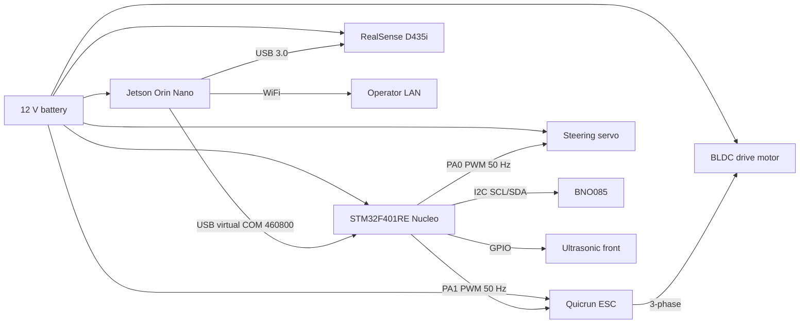

# Hardware Integration

Generated 2026-06-08. The OdyssiX BFMC 2026 vehicle is built on the BFMC reference chassis with an OdyssiX-engineered compute + sensing stack.

## Topology



## Compute

### Jetson Orin Nano

| Item | Value |
|---|---|
| Role | Autonomy compute. Runs perception, planning, control, fusion, safety, UI. |
| OS | Ubuntu 22.04 (JetPack 6.x) |
| ROS | ROS 2 Humble |
| GPU | Integrated Ampere; used for CUDA preprocess + TensorRT object detection. |
| Network | WiFi (LAN-only at race day). |

### STM32F401RE Nucleo

| Item | Value |
|---|---|
| Role | Vehicle firmware. Runs the BNO085 IMU read loop, the micro-ROS client, and the PWM steering/ESC outputs. |
| Clock | 84 MHz HSI |
| OS | FreeRTOS 10.3.1 |
| Application | `microROSTask` single user task (see embedded repo for detail) |
| Transport | USART2 @ 460 800 baud → Jetson via USB virtual COM |

## Sensing

### RealSense D435i (camera)

| Item | Value |
|---|---|
| Role | Color + depth source for perception. |
| Interface | USB 3.0 to Jetson |
| Streams | Color (RGB), Depth (rectified) |
| Rate | 15 Hz (configured in `docker/realsense_params.yaml`) |
| Notes | Built-in IMU is **not** used; the BNO085 is the authoritative IMU. |

### BNO085 (IMU)

| Item | Value |
|---|---|
| Role | Authoritative IMU for fusion. Mounted on the vehicle. |
| Interface | I²C @ 400 kHz to STM32 |
| Rate | ~100 Hz batched (Rotation Vector report 0x05) |
| Calibration | Boot-time STM32 calibration; firmware zeroes bias at boot. |

### Ultrasonic front

| Item | Value |
|---|---|
| Role | Front-obstacle range. Published by STM32 firmware. |
| Interface | GPIO on STM32 |
| Status at race-day | Stream is on the bus; no Jetson-side consumer in the deployed launch. |

## Actuation

### Steering servo

| Item | Value |
|---|---|
| Driver | STM32 TIM2 CH1 (PA0), 50 Hz, 1 µs counter resolution. |
| Range | Centre 1500 µs ± steering range (per firmware). |
| Failsafe | 500 ms command-silence deadman → 1500 µs neutral. |

### Quicrun ESC + BLDC drive motor

| Item | Value |
|---|---|
| Driver | STM32 TIM2 CH2 (PA1), 50 Hz, 1 µs counter resolution. |
| Range | Neutral 1500 µs; forward up to 1700 µs depending on Quicrun curve. |
| Failsafe | Same 500 ms deadman → neutral. |
| Race-day cap | Brain-side `abs_max_throttle=0.35`, `safety_supervisor` clamps. |

## Power

| Rail | Source | Loads |
|---|---|---|
| 12 V | Battery pack | Jetson Orin Nano (via DC-DC), ESC, servo |
| 5 V | Buck converter from 12 V | STM32 board, BNO085, ultrasonic |
| 3.3 V | STM32 onboard regulator | I²C / GPIO peripherals |

Detailed power schematics are part of the team's hardware repository (not in this software-only release). The deployed system is documented as a power topology only.

## Networking

| Interface | Role | Configuration |
|---|---|---|
| Jetson WiFi | Operator LAN (race day) | DHCP. CycloneDDS multicast on the LAN. |
| Container network | DDS bridge | `network_mode: host` — container shares Jetson network stack. |
| micro-ROS UART | Brain ↔ STM32 | 460 800 baud over USB virtual COM. |

### Race-day note

CycloneDDS runs with stock multicast on both the host autonomy stack and the docker container. A previous attempt to pin the host to a LAN-only XML profile (`config/cyclonedds_race.xml`) was reverted at the launch level because it bottlenecked the color image stream. The XML file ships with the repo and is available for opt-in but is not active in `race_day.launch.py`.

## USB topology

```
Jetson Orin Nano
   │
   ├── USB 3.0 ──▶ RealSense D435i
   │
   └── USB 2.0 (virtual COM) ──▶ STM32F401RE Nucleo
                                  (ST-LINK on-board USB)
                                  → /dev/ttyACM0
```

The STM32's ST-LINK on-board USB exposes USART2 as a virtual COM. No external FTDI is used.

## Mechanical (high level)

| Subsystem | Notes |
|---|---|
| Chassis | BFMC reference 1/10-scale platform. |
| Wheelbase | Per BFMC spec. |
| Steering | Ackermann via servo on front axle. |
| Drive | Single BLDC + Quicrun ESC on rear axle. |
| Camera mount | Forward-facing, ~0.235 m from base_link, ~0.155 m above (see `tf_static_base_to_camera` in race_day.launch.py). |
| IMU mount | On chassis near base_link, ~0.05 m above (see `tf_static_base_to_imu`). |

## TF tree (static portion)

```
map (origin)
   │
   ▼ (identity static transform)
odom
   │
   ▼ (dynamic, broadcast by tf2_publisher_node from /vehicle/state)
base_link
   ├── camera_link  (x=0.235, y=0, z=0.155, RPY=0,0,0)
   └── imu_link     (x=0, y=0, z=0.05, RPY=0,0,0)
```

The `map → odom` transform is static identity in the deployed launch; the localization client is configured to disable external map alignment (`server_host=''`).

## What this document does not claim

- Exact part numbers, supplier links, mechanical drawings — out of scope for the software release.
- Exact wiring harness colour codes / connector pinouts — owned by the OdyssiX hardware build documentation, separate.
- Battery chemistry, capacity, charge cycle — operator-managed.
- The Jetson Orin Nano's specific power-mode profile (`MAXN`, `7W`, etc.) — operator-managed.
